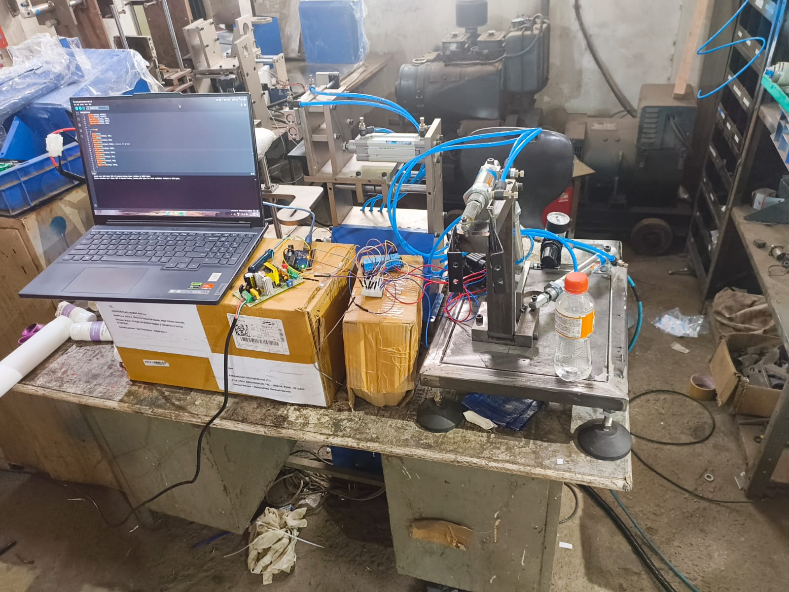
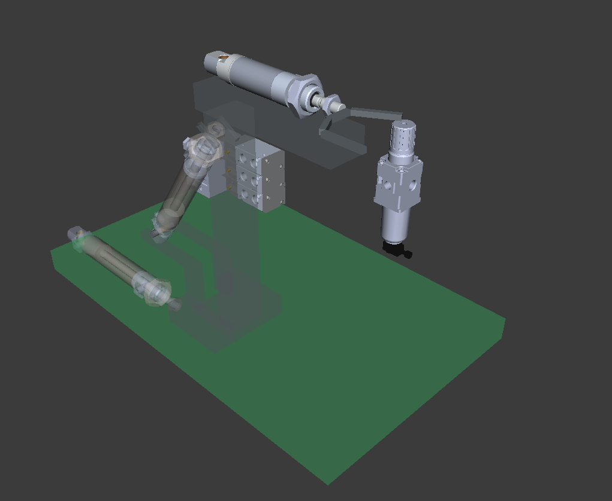
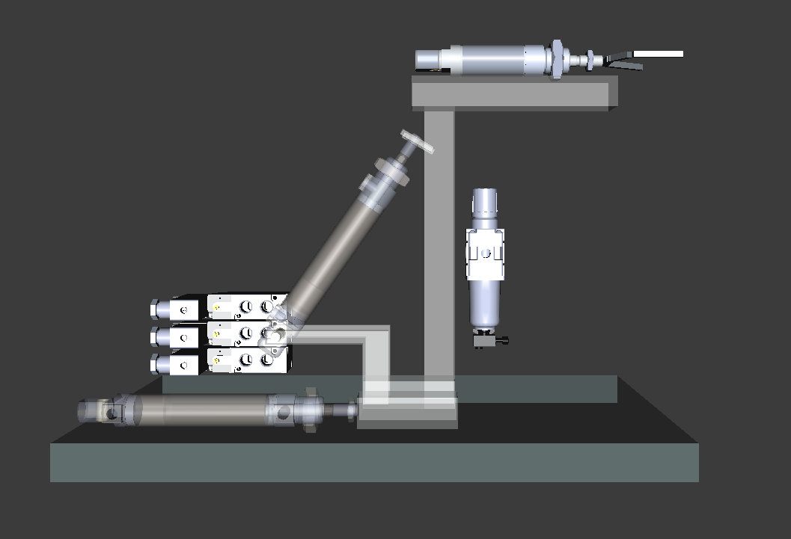
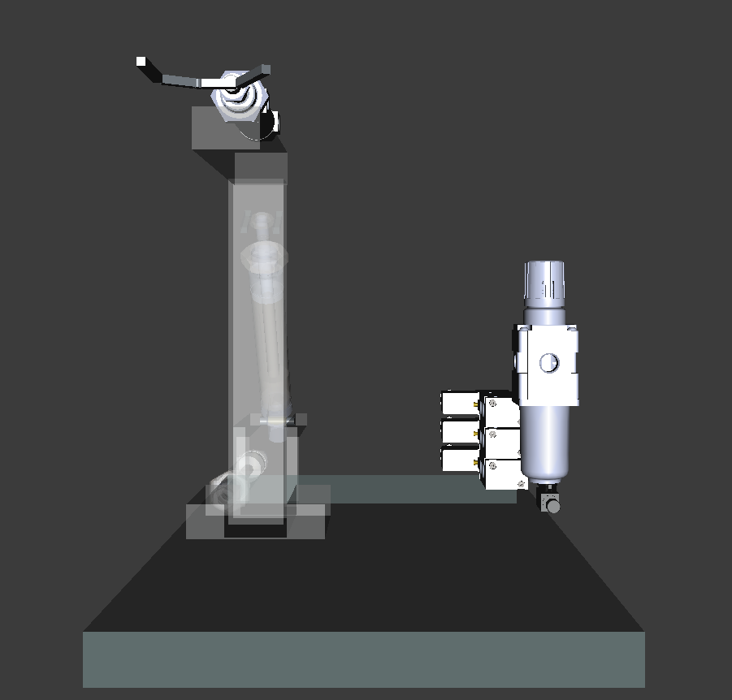
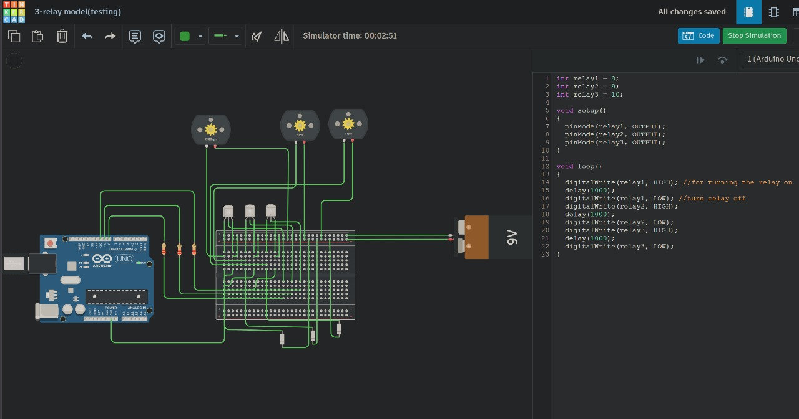
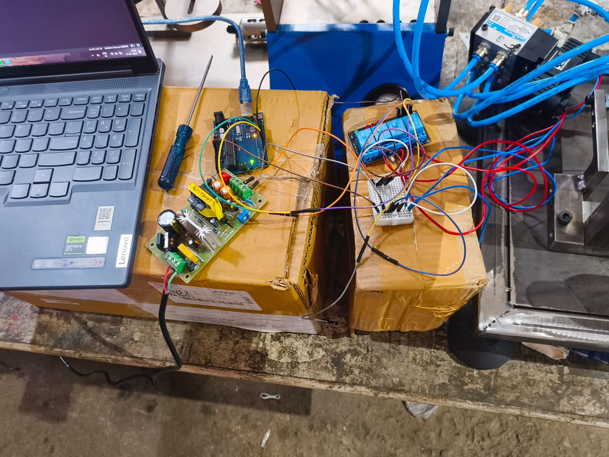
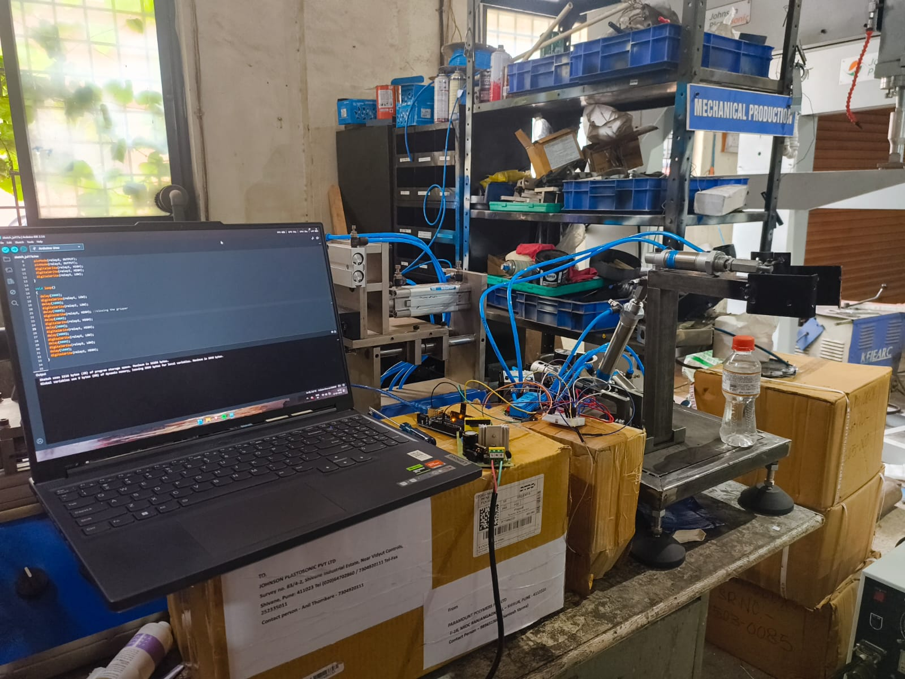

# Electro-Pneumatic Pick-and-Place Arm

An electro-pneumatic automation project combining mechanical design, pneumatic actuation, and electronic control to develop a pick-and-place mechanism.

## Project Overview

The objective is to develop a pneumatic arm capable of performing controlled mechanical movements for object handling. The project combines a fabricated mechanical structure, pneumatic cylinders, directional control valves, and Arduino-based control experimentation.

<p align="center">
  
</p>

<p align="center"><em>Physical prototype developed and tested in a workshop environment.</em></p>

## Key Features

- Pneumatic actuation using cylinders and directional control valves.
- Mechanical components designed in FreeCAD.
- Arduino-based relay control experimentation using Tinkercad.
- Native CAD models and STEP exports.
- Scope for future robotic simulation and digital-twin development.

## System Architecture

```text
Arduino Control
      |
      v
Relay Interface
      |
      v
Solenoid Valves
      |
      v
Pneumatic Cylinders
      |
      v
Arm and Gripper
      |
      v
Object Handling
```

The control system is intended to operate the pneumatic valves through electrical switching. The final actuator sequence and physical control implementation should be verified against the assembled prototype.

## Mechanical Design

The mechanism was modeled in FreeCAD, including the base,
support structure, pneumatic cylinders, gripper, and associated
mounting components.

<p align="center">
  
</p>

<p align="center">
  
  
</p>
## Hardware and Control

| Subsystem | Main components |
|---|---|
| Mechanical | Fabricated frame, arm components, mounting structure |
| Pneumatic | Cylinders, directional control valves, pneumatic tubing |
| Electronics | Arduino Uno, relay modules, wiring |
| Air supply | Compressed-air source and pneumatic connections |

### Relay-control experiment

A three-channel relay-sequencing experiment was created in Tinkercad to explore timed digital output switching using an Arduino Uno.

<p align="center">
  
</p>

The simulation demonstrates basic sequential relay switching. It is a separate control experiment and does not, by itself, verify the final firmware or wiring used on the physical prototype.

## Prototype Development

<p align="center">
  
</p>

<p align="center">
  
</p>


These photographs show the physical mechanism, pneumatic connections, and electronics used during development.

## Project Status

- Mechanical prototype assembled.
- FreeCAD models and STEP exports created.
- Basic Arduino relay-sequencing simulation completed.
- Physical control firmware and the complete operating sequence remain to be verified.

## Future Prototypes and Improvements

1. **Automated pick-and-place:** Verify and refine the actuator sequence and control logic.
2. **Digital twin:** Recreate the mechanism digitally and study its movement.
3. **ROS 2 simulation:** Develop a URDF model and simulate the mechanism in a robotics environment.
4. **Vision-assisted handling:** Explore camera-based object detection and position estimation.

## Technologies

`FreeCAD` · `Pneumatics` · `Arduino Uno` · `Relay Control` · `Tinkercad` · `STEP CAD`

